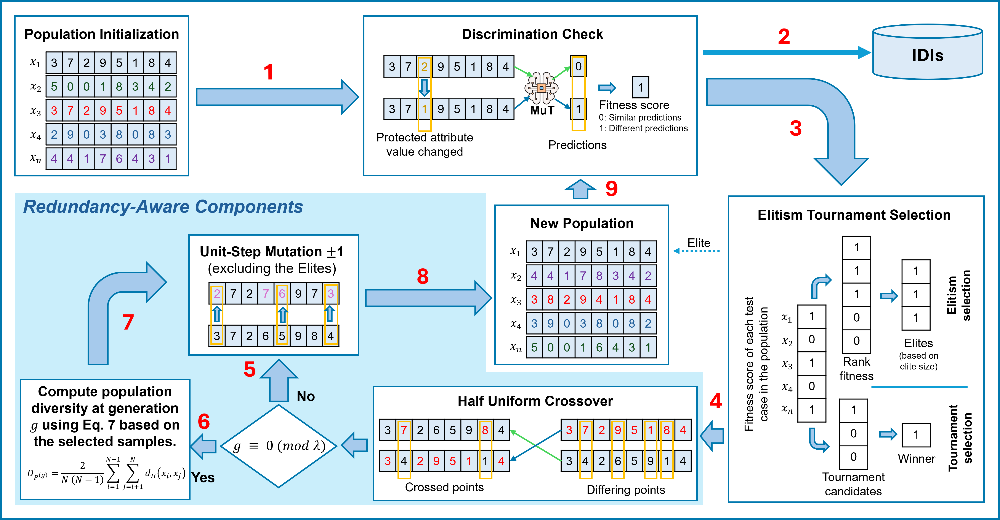

# RAES: Redundancy-Aware Evolutionary Search for Individual Fairness Testing

**Authors:** Hussaini Mamman, Abdullateef Oluwagbemiga Balogun, Shuib Basri, Muhammad Sabo Yahaya, Shamsuddeen Adamu, Puteri Azzatul Hanan Muzaisham, Muhammad Tella, Luiz Fernando Capretz

[](LICENSE)
[](https://www.python.org/downloads/)




## Abstract

RAES is a search-based approach for individual fairness testing that addresses the **redundancy limitation** of existing methods. Existing search-based Individual Fairness Testing (IFT) methods generate large amounts of redundant test inputs by repeatedly evaluating identical instances, wasting computational resources.

RAES integrates three complementary mechanisms:

- **Unit-Step Mutation**: Applies ±1 perturbations to ensure each mutation produces distinct offspring
- **Half-Uniform Crossover (HUX)**: Exchanges exactly half of differing genes to maximize recombination diversity
- **Diversity-Driven Adaptive Mutation**: Dynamically adjusts mutation rates based on population diversity

### Key Results

Evaluation across **5 benchmark datasets** and **3 ML models** shows:

- **55% more unique IDIs** detected on average
- **1.85× faster** IDI detection speed
- **17× lower redundancy** compared to state-of-the-art search-based methods
- **86% success rate** for multi-attribute fairness testing (vs. 42–66% for baselines)
- **54% reduction** in model discrimination after retraining

## Repository Structure

```
RAES/
├── tutorial/              # Core RAES implementation
│   ├── raes.py           # Main RAES algorithm
│   ├── genetic_algorithm.py   # Base GA components
│   └── adaptive_mutation.py   # Adaptive mutation strategies
├── baseline/              # Baseline implementations
│   ├── aft/              # AFT (Approximate Fairness Testing)
│   ├── expga/            # ExpGA (Explainability-guided GA)
│   ├── grft/             # GRFT (Global-Local Random Fairness Testing)
│   └── sbft/             # SBFT (Search-Based Fairness Testing)
├── datasets/              # Benchmark datasets
├── models/                # Pre-trained classifier models (RF, SVM, DNN)
├── results/               # Experiment results
├── utils/                 # Utility functions and helpers
├── main.py                # Main experiment runner
└── requirements.txt       # Python dependencies
```

## Installation

### Prerequisites

- Python 3.8 or higher
- pip package manager

### Setup

1. **Download the repository:**

   ```bash
   # Download from: https://anonymous.4open.science/r/RAES
   # Unzip and navigate to the directory
   cd RAES
   ```
2. **Create a virtual environment** (recommended):

   ```bash
   python -m venv venv

   # On Windows:
   venv\Scripts\activate

   # On Linux/macOS:
   source venv/bin/activate
   ```
3. **Install dependencies:**

   ```bash
   pip install -r requirements.txt
   ```

## Datasets

| Dataset        | Abbreviation | Protected Attributes | Features | Records | Task                       |
| -------------- | ------------ | -------------------- | -------- | ------- | -------------------------- |
| Bank Marketing | bank         | age, marital         | 16       | 45,211  | Term deposit prediction    |
| German Credit  | credit       | sex, age             | 20       | 600     | Credit risk classification |
| Adult Census   | census       | sex, race, age       | 13       | 48,842  | Income prediction          |
| COMPAS         | compas       | age, race, sex       | 12       | 7,214   | Recidivism risk assessment |
| MEPS           | meps         | sex                  | 40       | 15,675  | Health needs prediction    |

### Protected Attribute Indices

| Dataset | Protected Attribute | Column Index |
| ------- | ------------------- | ------------ |
| census  | sex                 | 9            |
|         | age                 | 1            |
|         | race                | 8            |
| credit  | sex                 | 9            |
|         | age                 | 13           |
| bank    | age                 | 1            |
|         | marital             | 3            |
| compas  | sex                 | 1            |
|         | age                 | 2            |
|         | race                | 3            |
| meps    | sex                 | 3            |

> **Note:** Dataset and protected attribute names are case-sensitive.

## Usage

### Command-Line Arguments

| Argument               | Type    | Default    | Description                                |
| ---------------------- | ------- | ---------- | ------------------------------------------ |
| `--dataset_name`     | string  | `census` | Dataset to use for testing                 |
| `--sensitive_name`   | string  | `age`    | Protected attribute for fairness testing   |
| `--classifier_name`  | string  | `dt`     | Classifier type (`rf`, `svm`, `dnn`) |
| `--max_allowed_time` | integer | `3600`   | Maximum runtime in seconds                 |

### Running Individual Experiments

**Run RAES:**

```bash
python ./tutorial/raes.py --classifier_name rf --dataset_name census --sensitive_name age --max_allowed_time 3600
```

**Run a baseline approach:**

```bash
# ExpGA
python ./baseline/expga/expga.py --classifier_name rf --dataset_name census --sensitive_name age --max_allowed_time 3600

# SBFT
python ./baseline/sbft/sbft.py --classifier_name rf --dataset_name census --sensitive_name age --max_allowed_time 3600

# GRFT
python ./baseline/grft/grft.py --classifier_name rf --dataset_name census --sensitive_name age --max_allowed_time 3600

# AFT
python ./baseline/aft/aft.py --classifier_name rf --dataset_name census --sensitive_name age --max_allowed_time 3600
```

### Running Full Experiments

To run all experiments for an approach across all dataset-classifier-attribute combinations:

```bash
python ./main.py --approach_name raes --max_allowed_time 3600 --max_iteration 1
```

**Available approaches:** `raes`, `expga`, `sbft`, `grft`, `aft`

## Reproducing Paper Results

The paper evaluates 33 single-attribute and 30 multi-attribute experimental configurations across all dataset-classifier-attribute combinations.

### Experimental Parameters

| Parameter               | Value     | Description                               |
| ----------------------- | --------- | ----------------------------------------- |
| Population size         | 300       | Number of individuals in the population   |
| Initial mutation rate   | 0.05      | Starting mutation probability             |
| Maximum mutation rate   | 0.5       | Upper bound for adaptive mutation         |
| Crossover rate          | 0.8       | Crossover probability                     |
| Elite percentage        | 10%       | Preserved solutions across generations    |
| Tournament size         | 5         | Tournament selection participants         |
| Diversity interval (λ) | 10        | Generations between diversity computation |
| Search budget           | 1,000,000 | Maximum test case evaluations             |
| Time limit              | 3,600s    | Maximum execution time per configuration  |

### Run All Experiments

```bash
# Run RAES experiments
python ./main.py --approach_name raes --max_allowed_time 3600 --max_iteration 1

# Run baseline comparisons
python ./main.py --approach_name expga --max_allowed_time 3600 --max_iteration 1
python ./main.py --approach_name sbft --max_allowed_time 3600 --max_iteration 1
python ./main.py --approach_name grft --max_allowed_time 3600 --max_iteration 1
python ./main.py --approach_name aft --max_allowed_time 3600 --max_iteration 1
```

Results are saved in the `results/` directory.

## Evaluation Metrics

### Effectiveness Metrics

- **#IDI**: Number of unique discriminatory instances detected
- **GSR**: Generation Success Rate (% of unique test cases that detected discrimination)
- **RR**: Redundancy Rate (% of duplicate test cases)

### Efficiency Metrics

- **TT**: Time to generate 1,000 IDIs (seconds)
- **EGS**: Effective Generation Speed (IDIs per second)

### Fairness Metrics

- **Acc**: Model accuracy after retraining
- **IF_o**: Individual Fairness in Original data
- **IF_r**: Individual Fairness in Random sample

## Requirements

Key dependencies:

- TensorFlow/Keras 3.5.0
- scikit-learn 1.4.2
- NumPy 1.26.4
- Pandas 1.5.3
- SHAP 0.46.0
- LIME 0.2.0.1

See `requirements.txt` for the complete list.

## License

This project is licensed under the MIT License - see the [LICENSE](LICENSE) file for details.

---

*This repository is provided as an anonymous replication package for double-blind peer review.*
